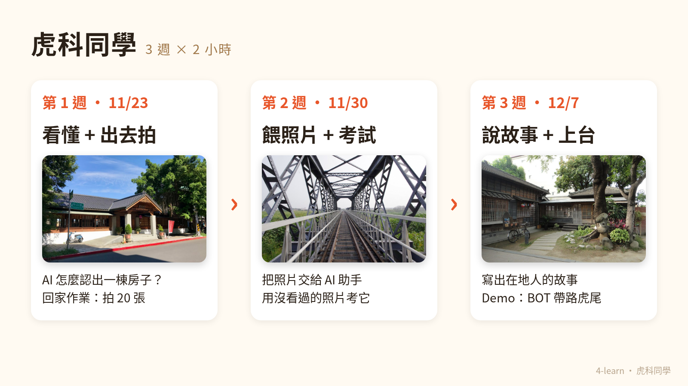

# 虎科同學

> 國立虎尾科技大學 通識｜拍照 → AI 認出虎尾地標 → 說在地故事
> 3 週 × 2 小時｜不用寫程式

| 週 | 日期 | 主題 | 講義 |
|---|---|---|---|
| 1 | 11/23（一）08:00–10:00 | 看懂 + 出去拍 | [第 1 週](week1/README.md) |
| 2 | 11/30（一）08:00–10:00 | 餵照片 + 考試 | 撰寫中 |
| 3 | 12/7（一）08:00–10:00 | 說故事 + 上台 | 撰寫中 |

## 你會用到

- 📱 手機（拍照、LINE）
- 💬 課程 AI 助手：`4-learn.4impact.cc`（第 1 週發帳號）

---

圖卡原始檔在 `assets/src/`，用 `node tools/render.mjs` 重新產圖。照片來源見 [assets/photos/CREDITS.md](assets/photos/CREDITS.md)。
