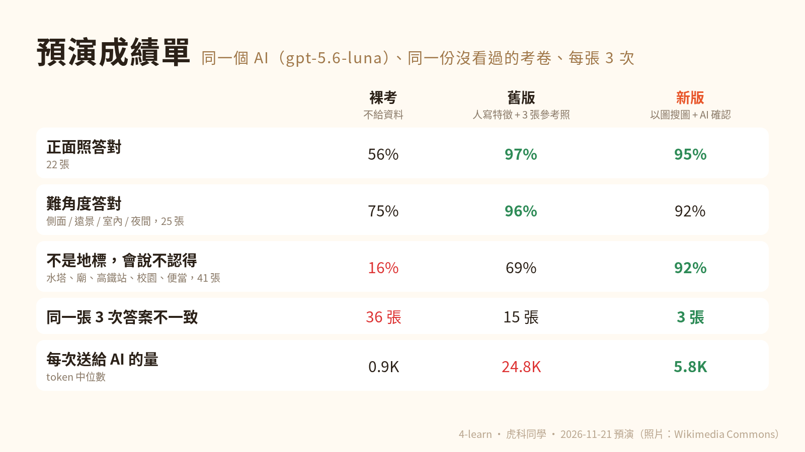

# 預演：舊版 vs 新版（2026-11-21）



## 規則

- **同一個 AI**：三組都用 `gpt-5.6-luna`
- **同一份考卷**：Wikimedia Commons 上的虎尾照片，兩版都沒調過
  - 8 個地標 50 張（扣掉 3 張跟舊版 golden 幾乎一樣的 → 47 張）
  - 41 張非地標：水塔、德興宮、高鐵雲林站、虎科大校園、AI 生成便當
- **每張考 3 次**，模型每次回答可能不同
- **舊版凍結**：直接用 rag-kit 的 Sheet（`old-sheet.csv`，40 列）、原 prompt、原 3 張參考照
- **新版**：CLIP（`Xenova/clip-vit-base-patch32`，本機 CPU）在相簿 94 張裡找前 3 名 → Luna 看參考照確認；最高相似度 < 0.72 直接回「不認得」
  - 0.72 是用**另一批**非地標照片（不在考卷內）校準的
- 考卷與相簿切分時，近乎重複的照片（CLIP 相似度 > 0.93）綁在同一邊

## 結果

| | 裸考 | 舊版 | 新版 |
|---|---|---|---|
| 正面照答對（22 張） | 56% | **97%** | 95% |
| 難角度答對（25 張） | 75% | **96%** | 92% |
| 非地標說不認得（41 張） | 16% | 69% | **92%** |
| 同一張 3 次不一致 | 36 張 | 15 張 | **3 張** |
| token 中位數 / 次 | 0.9K | 24.8K | **5.8K** |
| 秒數中位數 / 次 | 5.2 | 4.6 | **3.2** |

## 怎麼解讀

1. **認地標：打平。** 舊版略高 2–4 個百分點，但差距約等於 1–2 張照片，這個樣本量分不出勝負。
2. **不亂認：新版明顯贏。** 舊版的清單有 40 個地點、AI 被要求「從清單挑一個」，看到水塔就說「糖廠第一工場」、德興宮就說「福安宮」。新版離誰都遠就直接說不認得。
3. **穩定、便宜、快：新版贏。** prompt 從 15,000 字縮到只帶 3 個候選。
4. **新版還沒調過**：相簿只有 Commons 照片、門檻只校準一次。舊版是 Ch2–Ch4 調了好幾輪的結果。

## 新版答錯的

| 照片 | 新版答 | 原因 |
|---|---|---|
| 虎尾驛（正面） | 雲林故事館 | 兩棟都是日式木造 |
| 布袋戲館拘留所（室內） | 虎尾驛 | 相簿裡沒有拘留所 |
| 布袋戲館室內 | 不認得 | 相簿裡沒有室內照 |
| 第三公差宿舍 | 雲林故事館 | 舊版也錯在這張 |
| 4 張水塔 | 糖廠 / 酒精槽 | 同樣是紅磚、高塔 |

→ **相簿缺什麼角度，就錯在那裡**。這正是學生拍照作業要補的。

## 限制

- 照片來自 Commons，不是學生拍的；第 2 週要用學生照片重考一次
- 角度分類（正面 / 難）是人工看縮圖判的
- 舊版原本用 Gemini 2.5 Flash，這裡換成 Luna，比的是「方法」不是「原系統」

## 重跑

```bash
python3 dl.py            # 下載照片
node embed.mjs img emb-img.json
python3 split.py         # 切相簿 / 考卷
python3 bench.py new 3; python3 bench.py old 3; python3 bench.py bare 3
python3 score.py
```
