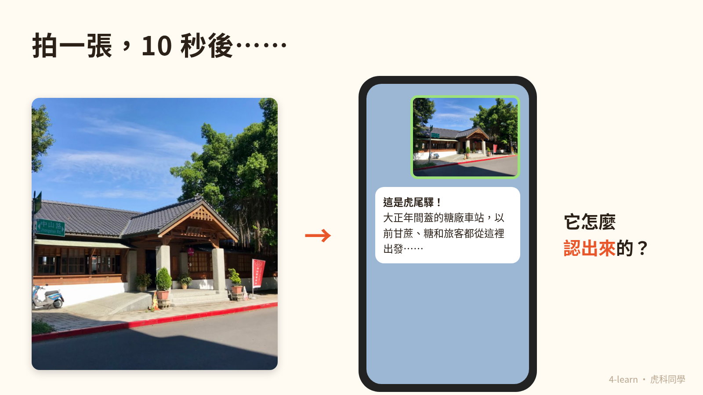
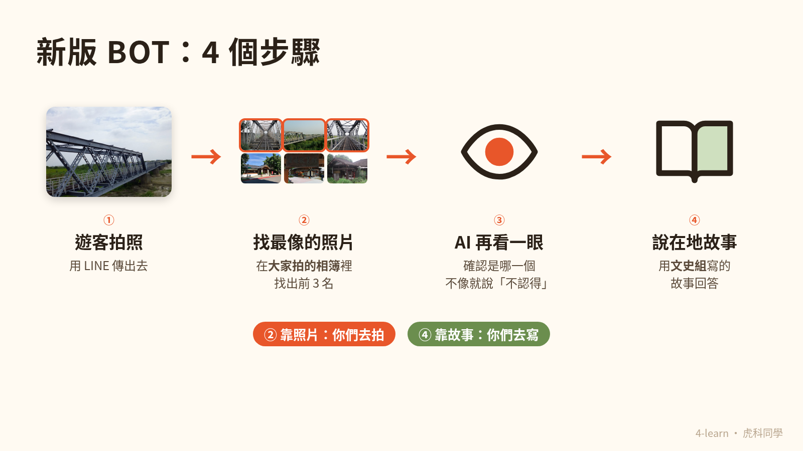

# 1-1 拍一張，10 秒後

遊客在虎尾拍了一張老房子，LINE 10 秒後回他：「這是虎尾驛」。

**這 10 秒裡發生了什麼？**

| 步驟 | 誰負責 |
|---|---|
| ② 找最像的照片 | **你們拍的照片** |
| ③ AI 再看一眼 | Gemini |
| ④ 說在地故事 | **你們寫的故事** |

> 💬 **想一想**：如果相簿裡沒有任何一張鐵橋的照片，步驟 ② 會找到什麼？

---
➡️ [1-2 認東西的方法，換過好幾代](1-2-era.md)
