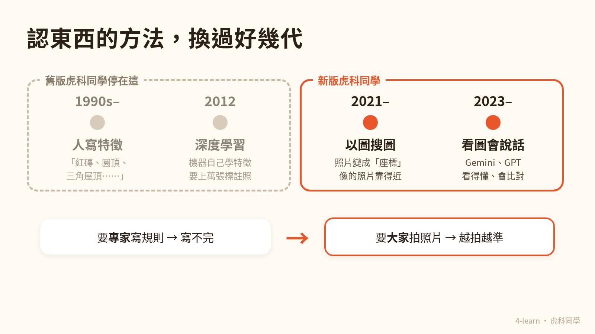
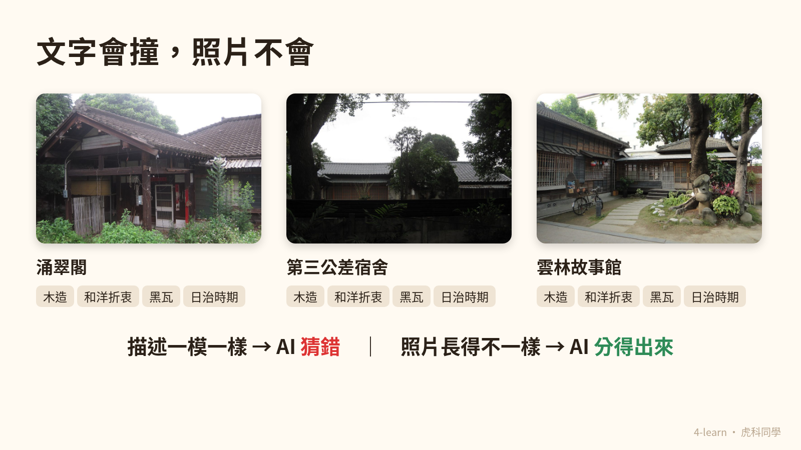

# 1-2 認東西的方法，換過好幾代

## 舊方法：人寫特徵

以前要教電腦認一棟房子，要靠**專家**一條一條寫：「木造、黑瓦、和洋折衷……」

三棟房子，**寫出來的字一模一樣**。

- 字寫越多 → 越容易撞
- 換個角度拍 → 寫好的字就對不上
- 每加一個地標 → 又要專家寫一輪

## 新方法：讓照片自己說話

| | 舊 | 新 |
|---|---|---|
| 誰出力 | 專家寫規則 | **大家拍照片** |
| 換角度拍 | 要補寫特徵 | 多拍一張就好 |
| 不認得的東西 | 硬挑一個 | 說「不認得」 |

> 💬 **想一想**：Google 相簿搜「狗」就跑出你家的狗。有人幫你寫過「狗有四隻腳、會搖尾巴」嗎？

---
➡️ [1-3 每張照片 = 地圖上一個點](1-3-photo-map.md)
