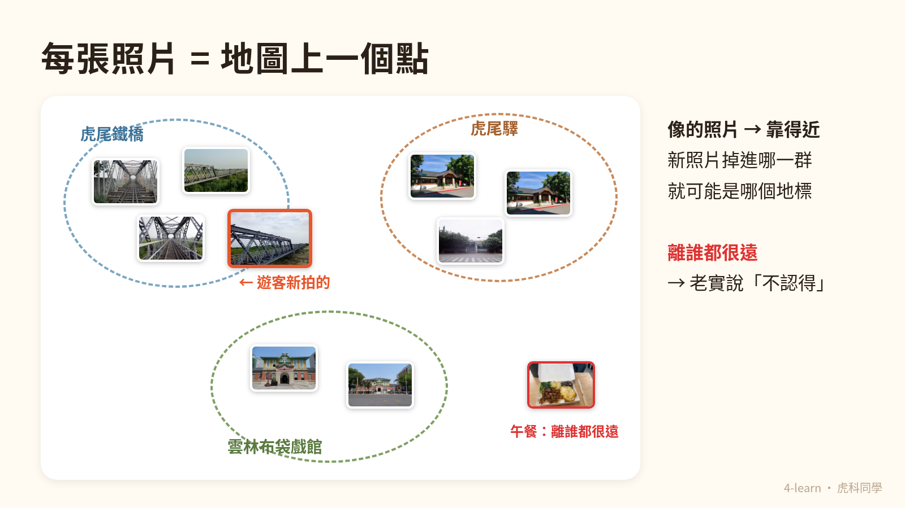
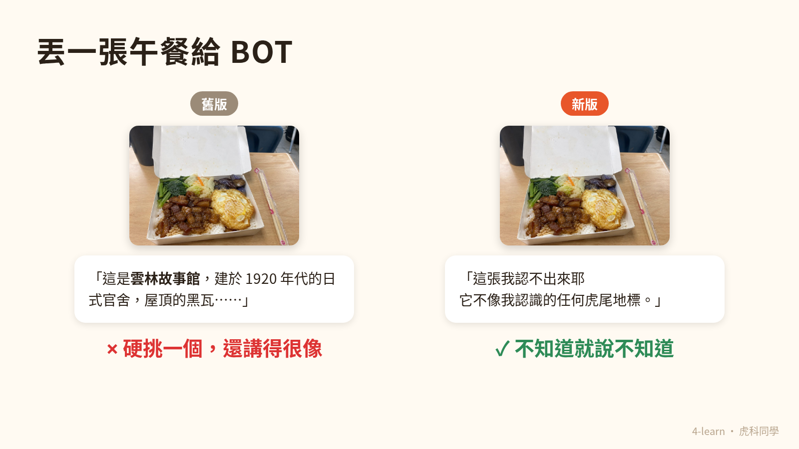

# 1-3 每張照片 = 地圖上一個點

AI 把每張照片變成**地圖上的一個點**：

- 長得像 → 靠得近
- 遊客新拍的照片掉進哪一群，就可能是哪個地標

## 那一張便當呢？

便當**離誰都很遠** → 新版 BOT 會老實說「不認得」。

> 💬 **想一想**：某個地標，相簿裡只有一張正面照。遊客從**側面**拍，會發生什麼事？

---
➡️ [1-4 動手：考考 AI](1-4-try-it.md)
