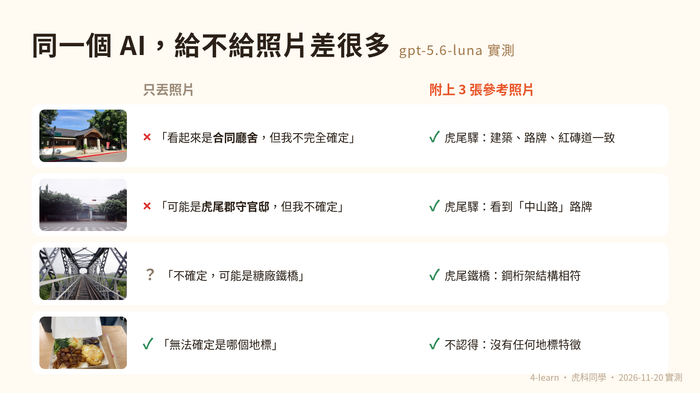

# 1-4 動手：考考 AI

> ⏱ 30 分鐘｜👥 2–3 人一組

## Step 1：登入課程 AI 助手（5 分）

1. 打開 `https://4-learn.4impact.cc`
2. 用老師發的小組帳號登入

> 🚧 站台開通後補上登入截圖

## Step 2：丟 3 張照片，看它怎麼回（15 分）

把照片拖進對話框，問：「**這是虎尾的哪個地標？不確定就說不確定。**」

| | 照片 | 先猜猜看 |
|---|---|---|
| A | 地標**正面** | 答得出來嗎？ |
| B | 同一個地標的**側面、遠景或室內** | 答得出來嗎？ |
| C | 你的**午餐、書包、自拍** | 會不會硬掰？ |

> 🤖 課程 AI 助手用的是 `gpt-5.6-luna`

照片哪裡來：

- 學校就在糖廠旁，**走出去拍**最好
- 或用老師的示範照：[assets/photos/](../assets/photos/)

## Step 3：截圖貼到小組共筆（5 分）

```
組名：
A 照片：＿＿　AI 說：＿＿　✓ / ✕
B 照片：＿＿　AI 說：＿＿　✓ / ✕
C 照片：＿＿　AI 說：＿＿　✓ / ✕
它最會「亂掰」的一句話：「＿＿」
```

## Step 4：揭曉 — 老師的實測（5 分）



- **只丟照片**：很聰明的 AI，也常常認錯虎尾的房子
- **附上參考照片**：同一個 AI，全部答對

> 💬 **想一想**：AI 沒有變聰明，只是**多看了幾張照片**。那這些照片要從哪裡來？

---
➡️ [1-5 回家作業：拍照任務](1-5-photo-mission.md)
