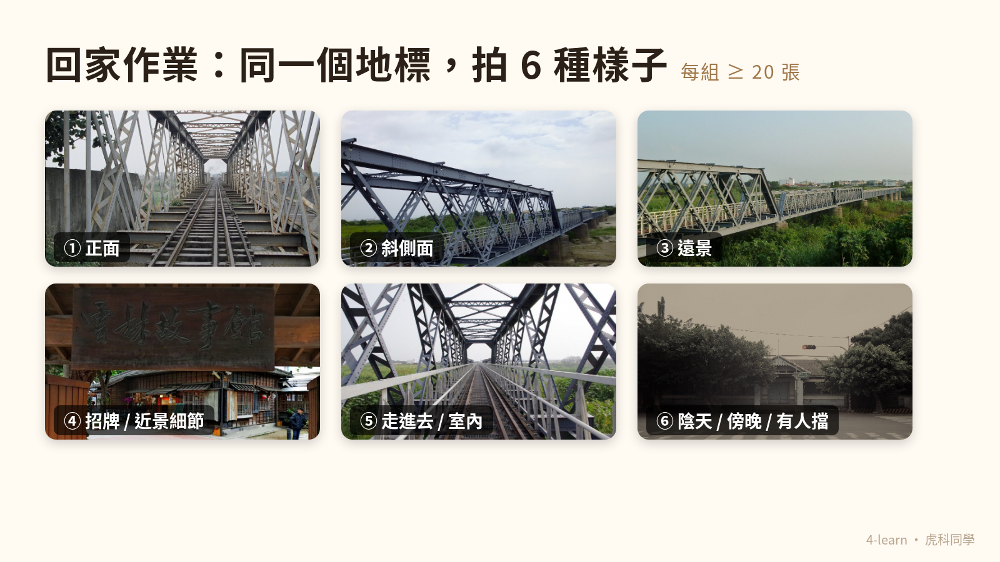
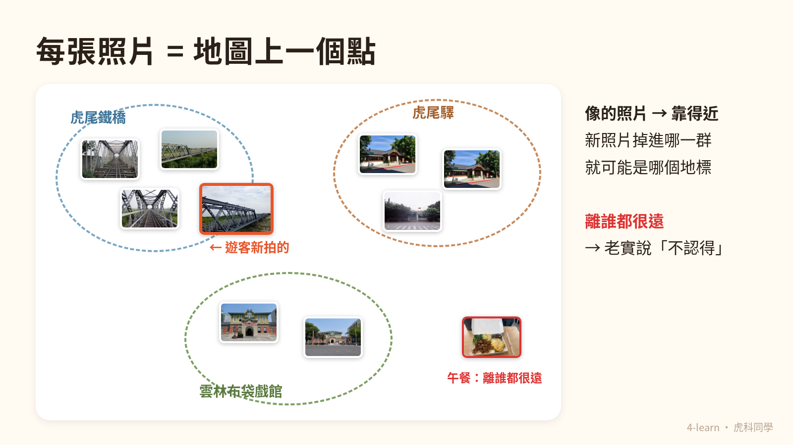

# 1-5 回家作業：拍照任務

> 📅 11/30 上課前完成

## 1. 認領地標（現在）

每組認領 **1 個**，先搶先贏：

| 地標 | 認領組 |
|---|---|
| 虎尾糖廠（廠區、煙囪） | |
| 虎尾糖廠酒精槽 | |
| 虎尾糖廠第三公差宿舍 | |
| 虎尾驛 | |
| 雲林布袋戲館 | |
| 雲林故事館 | |
| 涌翠閣 | |
| 合同廳舍 | |
| 屋頂上的貓 | |
| 虎尾鐵橋 | |

## 2. 拍照規則

- ✅ **每組 ≥ 20 張**，6 種樣子都要有
- ✅ 用手機直接拍，**不要**網路下載
- ✅ 至少 **3 張故意拍難一點**（遠、暗、被擋）
- ❌ 不要拍到路人的臉

## 3. 上傳

上傳到老師給的小組資料夾，**資料夾名稱 = 地標名**。

> 🚧 小組資料夾連結：上課時公布

## 4. 下週會用來做什麼

你們拍的照片 = 地圖上的點。**拍越多角度，BOT 越認得**。

下週我們會把其中幾張**藏起來**，用來考 BOT 👀

---
⬅️ [回第 1 週](README.md)
