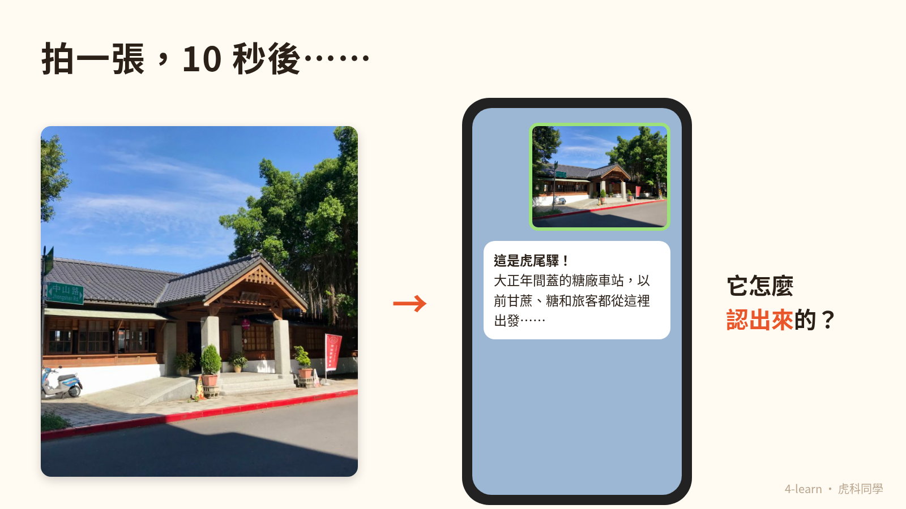

# 第 1 週：看懂 + 網路找照片

> 11/23（一）08:00–10:00

| 時間 | 單元 |
|---|---|
| 08:00–08:20 | [1-1 拍一張，10 秒後](1-1-ten-seconds.md) |
| 08:20–08:45 | [1-2 認東西的方法，換過好幾代](1-2-era.md) |
| 08:45–09:00 | [1-3 每張照片 = 地圖上一個點](1-3-photo-map.md) |
| 09:00–09:10 | 休息 |
| 09:10–09:40 | [1-4 動手：考考 AI](1-4-try-it.md) |
| 09:40–10:00 | [1-5 回家作業：拍照任務](1-5-photo-mission.md) |
